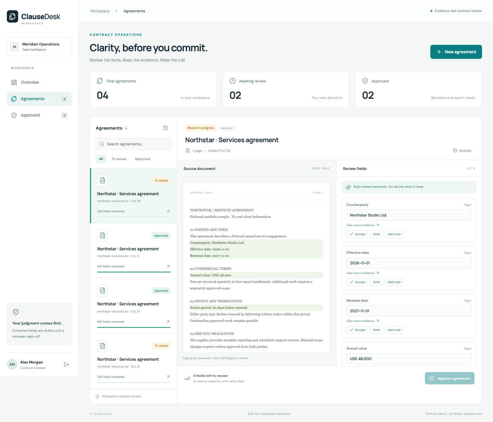

# ClauseDesk

**Contract review, with the evidence beside every decision.**

ClauseDesk turns a text PDF or plain-text agreement into a review workspace. Reviewers inspect six suggested fields, correct or explicitly omit them, approve the document, and export the reviewed facts. The original source remains unchanged and each decision is recorded with its reviewer.



## What works today

- PDF and UTF-8 text intake, with size/page limits and useful rejection messages.
- Side-by-side source and field review, with page-bound evidence highlighting.
- Explicit handling of missing and ambiguous fields—no guessed jurisdiction or dates.
- Corrections with explanations, omission reasons and an actor-attributed history.
- Server-enforced approval gates and locked approved documents.
- CSV export with spreadsheet-formula protection.
- Workspace isolation, reviewer/viewer roles and revocable eight-hour sessions.
- Responsive React interface, searchable agreement list and status filters.
- Opt-in, isolated two-hour public demo workspaces using fictional samples.
- AI provenance, token usage records, bounded attempts and concurrent-review protection.

**Two explicit extraction modes:** the default rules-based extractor recognizes labeled lines such as `Counterparty: Northstar Studio Ltd.` and works offline. Optional live AI uses OpenAI Responses with a strict schema, then checks exact values and citations against the source. Missing, ambiguous or unverifiable suggestions stay blank. Human review is required in either mode.

The AI adapter and failure paths are tested with synthetic provider responses; live-provider evaluation remains pending. The Fly demo at https://a3-clausedesk.fly.dev passed hosted visitor-isolation, review, approval and CSV-export checks on October 27, 2026. It is normally stopped for cost control: an operator must start it before a demonstration, and public requests cannot wake it. See [deployment operations](docs/DEPLOYMENT.md). Background processing remains planned.

This repository was republished from reviewed local source with fresh history on October 27, 2026. GitHub Actions is disabled; the CI definition is preserved as [an inactive example](docs/ci-workflow.yml.example). Earlier verification results describe the application before republication; no new build or test run is claimed. Enabling CI requires a separate review of execution permissions and dependencies.

All sample agreements are fictional. This is an independent portfolio application, not a client deliverable or a legal interpretation service.

## Stack

Ruby 3.4.8 · Rails 8.1 · PostgreSQL 16 · React 19 · TypeScript · Vite · Minitest · Playwright

Rails owns authorization, intake, review transitions and exports. React presents the workflow; PostgreSQL stores the source text, field decisions and audit events. The source PDF's bytes are fingerprinted; original binary files are not retained in this milestone.

## Run locally

Requirements: Ruby 3.4.8, Bundler, Node 22.12+ (or Node 24), and Docker Compose.

```bash
git clone https://github.com/aliahmeddev9/clausedesk.git
cd clausedesk
bundle install
npm ci --prefix frontend
docker compose up -d --wait db
DEMO_PASSWORD=local-demo-password bin/rails db:prepare
```

If the shell selects macOS system Ruby, use `rbenv local 3.4.8` and initialize rbenv, or run commands through `rbenv exec`.

Start the two development processes in separate terminals:

```bash
bin/rails server -b 127.0.0.1 -p 3017
npm run dev --prefix frontend
```

Open **http://127.0.0.1:5179**. Sign in with `reviewer@clausedesk.test` and the password supplied during setup. `viewer@clausedesk.test` uses the same setup password and has read-only access. These accounts are created only by local demo seeding; seeding is disabled in production. Set `PUBLIC_DEMO=true` on the Rails process to enable **Try a private demo** without a shared password.

The default database URL points at this project's Docker PostgreSQL instance on port **55432**. Override `DATABASE_URL` if needed. `.env.example` documents configuration; Rails does not automatically load `.env` files.

To update the local demo password later, run `DEMO_PASSWORD=your-new-local-password bin/rails db:seed`.

## Two-minute walkthrough

1. Sign in and select the seeded Northstar agreement, or choose **New agreement → Load fictional sample**.
2. Inspect the highlighted source text and accept the five explicit values.
3. Notice the missing governing-law field. Write `Not stated in source` and choose **Omit**.
4. Approve the agreement. It is now locked against edits.
5. Export the CSV and inspect **Activity** for the recorded decisions.

You can also upload `samples/northstar-services.txt` or another text PDF. Scanned/encrypted PDFs, files over 2 MB, more than 30 pages, and over 60,000 extracted characters are outside this milestone's intake limits.

## Verification

```bash
RAILS_ENV=test bin/rails db:prepare
bin/rails test
bundle exec brakeman -q --no-pager
npm run build --prefix frontend
npm run format:check --prefix frontend
```

For the browser tests, leave the local API running with `PUBLIC_DEMO=true` and the frontend running, and use a seeded demo password:

```bash
cd frontend
npx playwright install chromium
DEMO_PASSWORD=local-demo-password npm run test:e2e
```

The browser tests cover seeded login, review/approval/export, a mobile viewport and two isolated demo visitors. It writes screenshots to `docs/images/`; repeated runs create additional sample agreements.

## Container build

`Dockerfile` builds the React assets and packages them with Rails. It requires a PostgreSQL connection and a `SECRET_KEY_BASE` at runtime. The image intentionally contains no seeded accounts. Provision users through an operator-controlled process before exposing it.

```bash
docker build -t clausedesk .
```

For a real deployment, use HTTPS at the reverse proxy, an allowed host via `APP_HOST`, and a private database. The app assumes TLS termination in production. The image build is separate from provisioning a hosting account or publishing a live demo.

## Architecture and roadmap

- [Architecture, API and tradeoffs](docs/ARCHITECTURE.md)
- [Milestones and acceptance criteria](docs/ROADMAP.md)
- [Mobile screenshot](docs/images/review-mobile.png)

Next: configure and evaluate a live model, then add durable background jobs, account management and document revisions.

## Optional live AI extraction

Configure `OPENAI_API_KEY` and `OPENAI_MODEL` on the **Rails server only**. Choose an account-accessible model supporting Responses structured outputs; there is deliberately no implicit model or billing choice. Restart Rails, sign in to a non-demo workspace, open an unreviewed draft, check the disclosure that source text will be sent to OpenAI, and select **Extract with AI**.

- Exact source text is transmitted only after that explicit action. `store: false` is requested; this is not a promise about the provider's separate retention policy.
- Values and quotations must be literal substrings on the referenced page. This verifies textual support, not semantic correctness or legal meaning.
- Extraction takes at most 70 seconds per attempt; there are three attempts per document and no automatic provider retries. Configure the hosting request timeout accordingly.
- Failed requests preserve existing fields. A review made while extraction runs wins; the AI response is discarded with a conflict message.
- Model/prompt version, attempt status and returned token counts are recorded. Unknown provider usage on interrupted requests is not estimated; dollar-cost accounting is not implemented.
- Public demo visitors cannot upload files or invoke paid AI calls. Live model access is for operator-provisioned users.

```bash
# Offline validation of hand-authored outputs, not model-accuracy measurement:
bin/rails runner script/evaluate_extraction.rb
# Calls the configured provider for two small synthetic cases (incurs provider usage):
EVAL_LIVE=true bin/rails runner script/evaluate_extraction.rb
```

See [evaluation limitations](docs/evaluation/README.md), [deployment checklist](docs/DEPLOYMENT.md), and the [portfolio walkthrough](docs/SHOWCASE.md).
