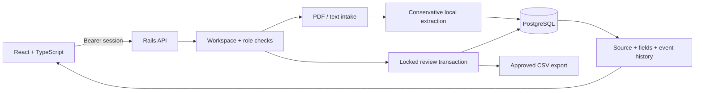

# Architecture

## Request flow

## Data model

A workspace owns users and documents. Documents hold immutable extracted source pages and a SHA-256 fingerprint of uploaded bytes. Six contract fields retain their original evidence and page reference while reviewers edit the value/decision. Every review mutation and approval creates a review event in the same database transaction.

`DocumentReview` takes a row lock and compares a client revision before changing anything. Concurrent or stale reviewers receive HTTP 409 and must reload. Approval requires all six fields to be accepted or explicitly omitted. Approved documents are immutable through the API.

The event history is application-level audit evidence, not a cryptographically tamper-proof log. Database administrators can modify records. Approval applies to reviewed data, not a legal conclusion about the contract.

## Access

Passwords use bcrypt. Session tokens are random, expire after eight hours and are stored as SHA-256 digests server-side. The browser holds a token in sessionStorage, sends it in Authorization, and revokes it on sign-out. No cookie authentication or cross-origin CORS access is enabled; Vite proxies same-origin `/api` requests locally. Workspace scoping applies to every document endpoint, including export. Viewer accounts cannot upload or mutate reviews.

Sensitive request fields are filtered from Rails logs. API responses use `Cache-Control: no-store`. Login and intake have per-process rate limits. A multi-instance production deployment would need a shared limiter and edge upload limits. sessionStorage limits token persistence but does not protect against a successful XSS attack; keep frontend dependencies and content handling controlled.

## API

| Method | Endpoint | Result |
|---|---|---|
| POST | `/api/session` | Email/password sign-in; token + user |
| GET / DELETE | `/api/session` | Current user / revoke token |
| GET | `/api/documents` | Latest 100 workspace agreements |
| POST | `/api/documents` | Multipart `title` + `file` intake |
| POST | `/api/documents/sample` | Create fictional sample |
| GET | `/api/documents/:id` | Pages, fields and event history |
| PATCH | `/api/documents/:id/fields/:field_id` | `revision`, `field: {value, review_state, note}` |
| POST | `/api/documents/:id/approve` | `revision`; approve completed review |
| GET | `/api/documents/:id/export` | Approved facts as CSV |

Errors use `{ "error": "Readable message" }`. 401 means sign-in required, 403 means role restriction, 404 covers absent/inaccessible records, 409 means stale revision, and 422 means invalid input or workflow transition.

## Deliberate first-milestone boundaries

- Extraction is synchronous and deterministic. It matches six explicit labels; it is not general document understanding and does not call an LLM.
- Repeated/conflicting labels remain unresolved, even when the values appear similar.
- PDF text extraction preserves pages, not original visual layout. OCR, encrypted files and original-binary storage are not included.
- Date/amount values are preserved as reviewed strings. No date arithmetic, currency conversion or legal interpretation is attempted.
- A correction requires an explanation; a missing field may be omitted with a reason. The system does not independently prove the reviewer's corrected value.
- Export excludes the value of omitted fields but retains the omission reason and evidence. Formula-like cells receive a leading apostrophe.
- Account provisioning is operator-managed. No sign-up, invitation, password reset or billing is implemented.
- No hosted public deployment has been provisioned. Docker packaging is a deployment foundation, not a claim of production readiness.

## Technical references

- [Rails API applications](https://guides.rubyonrails.org/api_app.html)
- [Vite guide](https://vite.dev/guide/)

## Optional AI and demo boundaries (October 26 increment)

`POST /api/documents/:id/extract` requires a reviewer, matching revision, non-demo workspace and entirely unreviewed draft. It reserves an `ExtractionRun` under the document lock, calls the provider outside the database transaction, validates six exact-source field objects, and locks again to check the revision before applying. Failure/conflict leaves fields unchanged. Three total attempts are allowed; an interrupted running marker expires after two minutes. Execution is synchronous, not a durable job queue.

`Ai::ValidatedFields` checks shape/types/lengths, exact page/quotation and value inclusion. It cannot establish that a cited amount is semantically the annual fee; reviewers still must read the source. Provider instructions treat document text as untrusted data, and the provider has no tools.

`POST /api/demo` is opt-in (`PUBLIC_DEMO=true`). Each visitor gets a fresh workspace/user/token, expires after two hours, and can create at most five fictional samples. Live AI and uploads are denied server-side. A PostgreSQL advisory lock serializes admission to a global 100-workspace / 24-hour limit. IP limits are additional per-process controls. Run `bin/rails demo:cleanup` daily to remove records older than 24 hours; keeping this full window preserves the admission cap. This is a bounded portfolio demo, not a general public document service.

Provider protocol: [OpenAI Structured Outputs](https://developers.openai.com/api/docs/guides/structured-outputs). Credentials stay server-side; neither provider raw responses nor exception messages are persisted.
